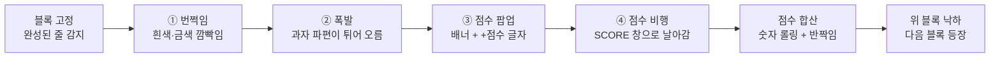
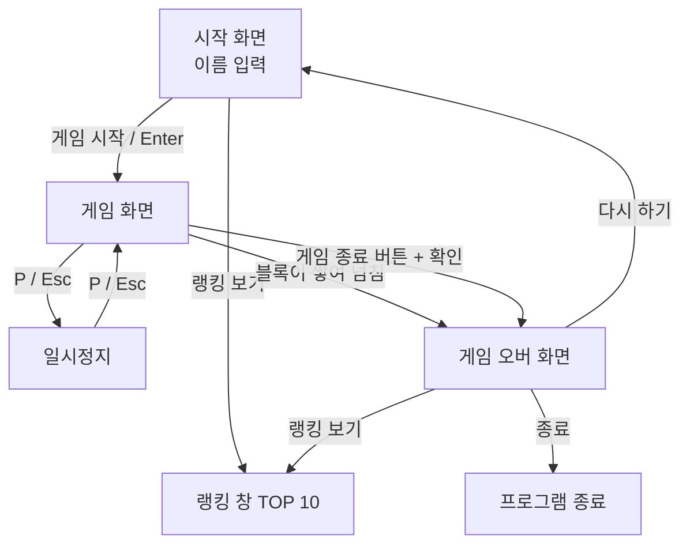
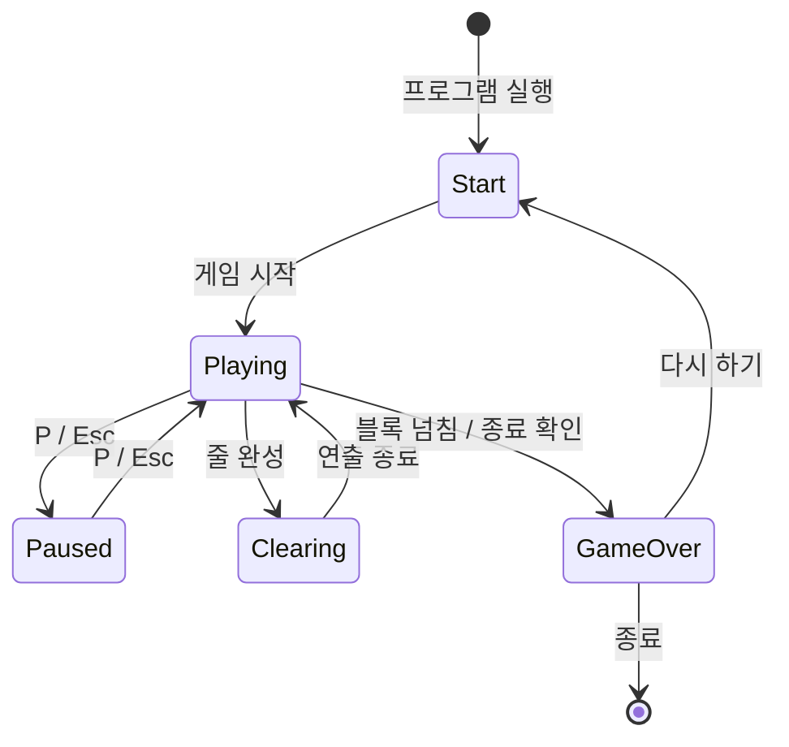

# 🍪 과자 테트리스 (Snack Tetris) 기획서

> 과자 블록을 쌓아 줄을 없애고, 터지는 연출과 함께 점수를 쌓아 랭킹에 도전하는 Python 데스크톱 테트리스 게임

| 항목 | 내용 |
|---|---|
| 프로젝트명 | 과자 테트리스 (Snack Tetris) |
| 제작자 | `[이름]` (`[학번]`) |
| 과목 / 제출일 | `[과목명]` / `[제출일]` |
| 개발 언어 | Python 3 |
| GUI | tkinter (표준 라이브러리) |
| 실행 파일 | `main.py` |

---

## 1. 프로젝트 개요

### 1.1 기획 배경
테트리스는 규칙이 단순하지만 입력 처리, 충돌 판정, 타이머, 화면 갱신 같은 프로그래밍 핵심 요소가 모두 들어 있는 대표적인 학습용 게임이다. 여기에 **'과자'라는 테마**와 **줄 제거 연출**을 더해, 기본 기능 구현에 그치지 않고 시각적 피드백과 플레이 재미까지 고려한 게임을 만드는 것을 목표로 했다.

### 1.2 기획 목표
1. 외부 이미지 파일 없이 **tkinter Canvas 도형만으로** 과자 느낌의 블록을 표현한다.
2. 줄을 지웠을 때 **'사라졌다'는 느낌이 아니라 '터져서 점수가 되었다'는 느낌**을 주는 연출을 구현한다.
3. 플레이어 이름과 점수를 **DB에 저장하고 TOP 10 랭킹**으로 보여 준다.
4. 입력 오류, 타이머 중복, 창 종료 시 오류 등 **안정성 문제를 줄인다.**

### 1.3 대상 사용자
- 가볍게 즐길 수 있는 데스크톱 퍼즐 게임을 원하는 사용자
- 친구와 점수를 비교하며 경쟁하고 싶은 사용자

---

## 2. 게임 기획

### 2.1 게임 규칙
- 10열 × 20행 보드 위로 7종류의 블록이 위에서 하나씩 떨어진다.
- 블록을 좌우로 움직이고 회전시켜 가로 한 줄을 빈칸 없이 채우면 그 줄이 제거되고 점수를 얻는다.
- 새 블록이 등장할 자리에 이미 블록이 쌓여 있으면 **게임 오버**가 되며, 결과가 DB에 저장된다.
- 제거한 줄이 10줄 늘 때마다 레벨이 오르고 낙하 속도가 빨라진다.

### 2.2 과자 블록 구성

| 블록 | 과자 이름 | 색상 | 표면 장식(Canvas 도형) |
|---|---|---|---|
| I | 막대과자 | `#c78a43` | 세로 홈 무늬 |
| O | 초코쿠키 | `#9a5a32` | 초코칩 |
| T | 젤리 | `#ec4e92` | 반짝이는 하이라이트 |
| S | 캐러멜 | `#d99a45` | 소용돌이 곡선 |
| Z | 초콜릿 | `#6b3d2a` | 초코칩 |
| J | 사탕 | `#49b8dc` | 사선 줄무늬 |
| L | 웨하스 | `#e8c77b` | 십자 격자 무늬 |

### 2.3 조작 방법

| 키 | 동작 |
|---|---|
| ← / → | 좌우 이동 |
| ↑ 또는 X | 시계 방향 회전 |
| Z | 반시계 방향 회전 |
| ↓ | 한 칸 빠르게 내리기 (소프트 드롭) |
| Space | 맨 아래로 즉시 내리기 (하드 드롭) |
| P 또는 Esc | 일시정지 / 재개 |

### 2.4 점수 및 레벨 체계

| 항목 | 규칙 |
|---|---|
| 소프트 드롭 | 내려간 칸 수 × 1점 |
| 하드 드롭 | 내려간 칸 수 × 2점 |
| 1줄 제거 | 100점 × 레벨 |
| 2줄 제거 | 300점 × 레벨 |
| 3줄 제거 | 500점 × 레벨 |
| 4줄 제거 (TETRIS) | 800점 × 레벨 |
| 레벨 | `제거한 줄 수 ÷ 10 + 1` |
| 낙하 간격 | `max(90ms, 800ms − (레벨−1) × 65ms)` |

> 한 번에 많은 줄을 지울수록 줄당 점수가 커지도록 설계하여, 위험을 감수하고 쌓아 올리는 플레이에 보상을 준다.

---

## 3. 주요 기능

### 3.1 기능 목록

| 구분 | 기능 | 설명 |
|---|---|---|
| 핵심 | 블록 이동·회전·낙하 | 충돌 판정 기반 이동, 시계/반시계 회전 |
| 핵심 | 줄 제거 및 점수 계산 | 줄 수·레벨에 따른 점수 |
| 편의 | 다음 블록 미리보기 | 우측 NEXT 영역에 표시 |
| 편의 | 고스트 블록 | 블록이 떨어질 위치를 윤곽선으로 표시 |
| 편의 | 일시정지 | 정지 중에는 보드를 가려 계획을 세우는 것을 방지 |
| 저장 | 플레이어 이름 입력 | 최대 20자 |
| 저장 | 기록 저장 및 TOP 10 랭킹 | 이름·점수·줄·레벨·일시 |
| 연출 | 줄 제거 이펙트 | 번쩍임 → 폭발 → 점수 비행 → 합산 (3.2 참고) |

### 3.2 핵심 차별 기능: 줄 제거 연출

기존에는 줄이 완성되는 즉시 아무 반응 없이 사라져 타격감이 없었다. 이를 개선해 **게임을 잠깐 멈추고 4단계 연출**을 보여 준다.



**줄 수가 많을수록 연출이 커진다.**

| 줄 수 | 배너 | 파편 수(최대) | 추가 효과 |
|---|---|---|---|
| 1줄 | SINGLE | 약 30개 | 기본 연출 |
| 2줄 | DOUBLE! | 약 90개 | 반짝이 별, 약한 화면 흔들림 |
| 3줄 | TRIPLE!! | 약 170개 | 충격파 링, 흔들림 강화 |
| 4줄 | TETRIS!!! | 약 270개 | 무지개색 배너, 가장 큰 점수 글자, 강한 흔들림 |

- 연출 중에는 입력과 일시정지가 잠시 막히고, 연출이 끝나면 위쪽 블록이 내려오며 게임이 재개된다.
- 점수는 **점수 글자가 SCORE 창에 도착하는 순간** 실제로 더해지며, 숫자가 올라가는 롤링 효과가 이어진다.
- 연출 길이와 강도는 소스 상단의 `CLEAR_FX`, `FRAME_MS`, `POP_FRAMES`, `FLY_FRAMES` 상수로 조절할 수 있다.

### 3.3 안정성 및 게임성 개선 사항

| 구분 | 개선 내용 |
|---|---|
| 블록 생성 | 순수 랜덤 대신 **7-bag 방식**(7종을 섞어 한 번씩 사용)으로 같은 블록이 몰리는 현상 방지 |
| 회전 | 벽·바닥 근처에서 막히지 않도록 **월 킥(Wall Kick)** 적용 (좌우 ±3칸, 위쪽 보정) |
| 소프트 드롭 | 바닥에 닿아도 즉시 고정하지 않아, 키를 누르고 있을 때 블록이 연쇄로 고정되는 문제 해결 |
| 타이머 | 하드 드롭 직후 낙하 타이머를 재시작하고, 창 종료·게임 오버 시 예약된 타이머를 모두 취소 |
| 확인창 | '게임 종료' 확인창이 떠 있는 동안 게임이 자동으로 일시정지 |
| 키 바인딩 | 게임 중에만 활성화하고 종료 시 해제 |
| 랭킹 창 | 중복으로 열리지 않도록 처리, DB 오류 시 안내 메시지 표시 |
| 렌더링 | 격자는 한 번만 그리고 움직이는 요소만 다시 그려 입력 시 부하 감소 |

---

## 4. 화면 설계

### 4.1 화면 흐름



### 4.2 시작 화면

```
┌──────────────────────────────────┐
│       🍪 과자 테트리스 🍫        │
│  과자 블록을 쌓고 최고 점수에    │
│          도전하세요!             │
│                                  │
│         플레이어 이름            │
│        [   Player      ]         │
│                                  │
│          [ 게임 시작 ]           │
│          [ 랭킹 보기 ]           │
│                                  │
│  ← → 이동  ↑/X 회전  Z 반대 회전 │
│  ↓ 빠른 하강  Space 즉시 하강    │
└──────────────────────────────────┘
```

### 4.3 게임 화면

```
┌───────────────────┬─────────────────┐
│                   │ SNACK TETRIS    │
│                   │ ┌─────────────┐ │
│                   │ │ SCORE   0   │ │
│   10 × 20 보드    │ │ LEVEL   1   │ │
│   (300 × 600 px)  │ │ LINES   0   │ │
│                   │ └─────────────┘ │
│  · 쌓인 과자 블록 │ NEXT SNACK      │
│  · 고스트 윤곽선  │ ┌─────────────┐ │
│  · 줄 제거 이펙트 │ │  다음 블록  │ │
│                   │ └─────────────┘ │
│                   │ [ 일시정지 (P) ]│
│                   │ [   게임 종료  ]│
│                   │ PLAYER: 이름    │
└───────────────────┴─────────────────┘
```

### 4.4 게임 오버 / 랭킹 화면
- **게임 오버**: `GAME OVER`, 플레이어 이름과 최종 점수, 제거한 줄·레벨, [다시 하기] [랭킹 보기] [종료] 버튼
- **랭킹 창**: 순위 · 이름 · 점수 · 줄 · 레벨 · 날짜 컬럼의 TOP 10 표 (기록이 없으면 안내 문구 표시)

### 4.5 디자인 컨셉
- 어두운 초콜릿 톤 배경(`#201912`, `#211a14`)에 따뜻한 베이지·캐러멜 계열 글자색
- 폰트: 맑은 고딕
- 모든 블록과 이펙트는 별도 이미지 없이 **Canvas 도형(사각형·원·호·선·다각형)** 으로만 표현

---

## 5. 시스템 설계

### 5.1 기술 스택

| 구분 | 내용 |
|---|---|
| 언어 | Python 3 |
| GUI | tkinter (Canvas, Frame, Label, Button, Entry, Treeview) |
| 난수 | `random` (블록 섞기, 파편 방향·속도) |
| 데이터 저장 | `database.py` 모듈 (기록 저장·조회) — `[사용한 DB 종류를 기입: 예) SQLite]` |

### 5.2 파일 구조

```
snack-tetris/
├── main.py        # 게임 로직 · 화면 · 연출 (TetrisApp 클래스)
├── database.py    # 기록 저장/조회 (init_db, save_record, get_top_records)
├── 기획서.md      # 본 문서
└── README.md
```

### 5.3 모듈 구성

`main.py`는 `TetrisApp` 클래스 하나가 화면 전환·게임 진행·그리기를 담당하고, 보조 함수와 설정 상수가 그 위에 정의되어 있다.

| 구분 | 주요 요소 | 역할 |
|---|---|---|
| 설정 상수 | `COLS, ROWS, CELL`, `SHAPES`, `SNACKS`, `KICKS`, `LINE_POINTS`, `CLEAR_FX` | 보드 크기, 블록 모양·색, 회전 보정, 점수, 연출 강도 |
| 보조 함수 | `rotate_matrix`, `rotate_matrix_ccw`, `mix_color`, `ease_out_back`, `star_points` | 회전, 색 혼합(페이드), 팝 효과 이징, 별 좌표 |
| 화면 | `build_start_screen`, `build_game_screen`, `show_game_over_screen`, `show_ranking` | 각 화면 구성 |
| 게임 진행 | `start_game`, `spawn_piece`, `move`, `rotate`, `soft_drop`, `hard_drop`, `lock_piece`, `tick` | 입력 처리, 낙하, 고정 |
| 충돌/블록 | `collides`, `make_piece`, `next_key_from_bag` | 충돌 판정, 7-bag 생성 |
| 그리기 | `draw`, `draw_grid`, `draw_next`, `draw_snack_cell` | 보드·블록·다음 블록 렌더링 |
| 줄 제거 연출 | `start_clear_animation`, `anim_frame`, `fx_flash`, `fx_begin_burst`, `fx_update_burst`, `fx_launch_badge`, `fx_arrive`, `finish_clear` | 번쩍임 → 폭발 → 점수 비행 → 합산 |
| 점수 표시 | `update_stats`, `start_score_roll`, `roll_step` | 점수창 갱신, 숫자 롤링 |
| 제어 | `schedule_tick`, `toggle_pause`, `game_over`, `quit_game`, `on_close` | 타이머, 일시정지, 종료 처리 |

### 5.4 핵심 동작 원리

**① 보드 표현**
보드는 `ROWS × COLS` 2차원 리스트이며 빈칸은 `None`, 블록이 있으면 종류 문자(`"I"`, `"T"` 등)를 저장한다. 블록 모양은 0/1 행렬로 정의하고, 회전은 행렬 회전으로 구현한다.

**② 충돌 판정**
`collides(x, y, matrix)`가 블록의 각 칸이 보드 밖(좌·우·아래)으로 나가거나 이미 쌓인 칸과 겹치는지 검사한다. 이동·회전·고스트 계산·게임 오버 판정이 모두 이 함수를 공유한다.

**③ 게임 루프**
`root.after()`로 낙하 간격(레벨에 따라 800ms → 최소 90ms)마다 `tick`을 호출한다. 한 칸 내려갈 수 없으면 블록을 보드에 고정(`lock_piece`)하고 완성된 줄이 있는지 검사한다.

**④ 줄 제거 연출의 상태 관리**
완성된 줄이 있으면 `animating` 상태로 전환해 입력과 낙하 타이머를 멈추고, 25ms 간격 프레임 루프(`anim_frame`)로 연출을 진행한다. 연출이 끝나면(`finish_clear`) 줄을 실제로 제거하고 다음 블록을 등장시킨 뒤 낙하 타이머를 재개한다. 화면 흔들림, 파편 이동, 글자 팝 효과는 모두 프레임 번호를 기준으로 계산한다.

**⑤ 점수 글자의 이동**
점수 글자는 보드(Canvas)와 점수창(Label)이 서로 다른 위젯이라는 점을 고려해, 팝업이 끝나는 시점에 같은 위치의 Label로 교체한 뒤 베지어 곡선을 따라 점수창까지 이동시킨다. 도착하면 점수를 더하고 롤링을 시작한다.

### 5.5 게임 상태



### 5.6 데이터 설계 (랭킹)

게임 오버 시 `save_record(player_name, score, lines, level)`로 기록을 저장하고, 랭킹 창에서 `get_top_records(10)`으로 상위 10건을 조회한다.

| 필드 | 설명 |
|---|---|
| player_name | 플레이어 이름 (최대 20자) |
| score | 최종 점수 |
| lines | 제거한 줄 수 |
| level | 도달한 레벨 |
| played_at | 플레이 일시 |

> 점수 내림차순으로 정렬해 상위 10건을 표시한다. `[DB 종류·테이블 구조는 database.py 구현에 맞게 보완]`

---

## 6. 실행 방법

```bash
# 1) 저장소 내려받기
git clone <저장소 주소>
cd snack-tetris

# 2) 실행 (Python 3.8 이상, tkinter 포함)
python main.py
```

- tkinter는 Python 기본 설치에 포함되어 있다. (Linux는 `sudo apt install python3-tk`가 필요할 수 있다.)
- 폰트는 Windows 기본 폰트인 '맑은 고딕'을 기준으로 디자인했다. 다른 OS에서는 대체 폰트로 표시될 수 있다.

---

## 7. 개발 과정 및 개선 이력

| 단계 | 내용 |
|---|---|
| 1단계 | 기본 테트리스 구현: 블록 이동·회전·줄 제거, 과자 테마 블록, 고스트 블록, 랭킹 저장 |
| 2단계 | 코드 분석 후 **안정성·게임성 개선**: 7-bag, 월 킥, 소프트 드롭 고정 문제, 타이머·키 바인딩 정리, 렌더링 최적화 (3.3 참고) |
| 3단계 | **줄 제거 연출 추가**: 즉시 사라지던 줄을 폭발·점수 비행·합산 연출로 개선하고 줄 수에 따라 강도 차등 적용 (3.2 참고) |

---

## 8. 한계 및 향후 계획

### 8.1 현재 한계
- 블록이 바닥에 닿으면 곧바로 다음 낙하 틱에서 고정되며, 별도의 고정 지연(Lock Delay)은 없다.
- 사운드(효과음·배경음)가 없다.
- 일부 블록(I·S·L, O·Z)의 색이 비슷해 구분이 어려울 수 있다.
- 줄 제거 연출은 Canvas 아이템을 직접 생성·이동하므로, 매우 낮은 사양에서는 프레임이 떨어질 수 있다.

### 8.2 향후 계획
- 홀드(Hold) 기능, 바닥 고정 지연, 콤보·T-스핀 보너스 점수
- 효과음과 배경음악
- 난이도 선택, 색약 사용자를 위한 블록 구분 모드
- 랭킹 화면에 내 순위 강조 및 최고 점수 표시

---

## 9. 기대 효과
- 이벤트 기반 GUI 프로그래밍(타이머, 키 입력, 화면 전환)과 2차원 배열 기반 게임 로직을 직접 구현하며 학습할 수 있다.
- 외부 리소스 없이 도형만으로 시각 효과를 만들어, 그래픽 라이브러리 없이도 풍부한 피드백을 줄 수 있음을 보인다.
- 기록 저장과 랭킹 조회로 단순 게임을 넘어 **데이터 저장·조회가 연동된 응용 프로그램** 형태를 갖춘다.
